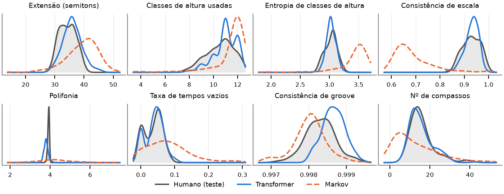

# Corais de Bach com Transformer — Trabalho Final de IA & Música

Geração **incondicional** (composição livre, a partir do zero) de corais a quatro vozes no
estilo de J. S. Bach, com um **Transformer autoregressivo implementado em PyTorch puro**
sobre tokens **REMI**, comparado a um **baseline de cadeia de Markov** de ordem *n*
(extensão da cadeia do TP1) treinado nos mesmos dados e na mesma representação.

- **Dataset:** JSB Chorales (Boulanger-Lewandowski et al., 2012), partição oficial
  229 / 76 / 77 corais (treino / validação / teste), versão em semicolcheias de
  Huang et al. (2017).
- **Representação:** REMI via `miditok` (`Bar`, `Position`, `Pitch`, `Duration`;
  106 tokens).
- **Modelo:** decoder-only com `nn.TransformerEncoderLayer` + máscara causal
  (4 camadas, d=256, 3,45 M parâmetros); laço de treino e amostragem
  (temperatura, top-k, top-p) escritos à mão.
- **Baseline:** cadeia de Markov de ordem *n* com interpolação de Witten–Bell
  (n escolhido na validação).
- **Avaliação:** 200 peças por sistema contra as 77 do teste, 7 métricas do `muspy`,
  comparação de distribuições por área de sobreposição (OA) e divergência KL
  (Yang & Lerch, 2020).

Artigo (formato ISMIR, LaTeX): [`paper/main.tex`](paper/main.tex). Compile com pdfLaTeX + BibTeX
(por exemplo, envie a pasta `paper/` ao Overleaf).

## Resultados principais

| | Teste (humano) | Transformer | Markov (n = 5) |
|---|---|---|---|
| NLL de validação (nats/token) / perplexidade | — | **1,098 / 3,00** | 1,853 / 6,38 |
| Entropia de classes de altura (μ ± σ; OA) | 3,03 ± 0,10 | 3,03 ± 0,08; **0,92** | 3,40 ± 0,34; 0,20 |
| Consistência de escala (μ ± σ; OA) | 0,930 ± 0,035 | 0,930 ± 0,028; **0,92** | 0,688 ± 0,080; 0,09 |
| Polifonia (μ ± σ; OA) | 3,92 ± 0,04 | 3,80 ± 0,11; **0,44** | 4,29 ± 1,00; 0,15 |
| Nº de compassos (μ ± σ; OA) | 15,9 ± 6,0 | 15,5 ± 5,7; **0,95** | 13,1 ± 11,6; 0,68 |
| Ataques com exatamente 4 notas | 92 % | 62 % | 18 % |

OA = área de sobreposição entre as distribuições de distâncias intra-teste e
gerado–teste (Yang & Lerch, 2020); quanto maior, melhor. A tabela completa, com as 7
métricas, OA e KL, está em [`results/metrics_table.txt`](results/metrics_table.txt) e no
artigo; as curvas de treino estão em [`figures/training.pdf`](figures/training.pdf) e as
distribuições em [`figures/metrics.pdf`](figures/metrics.pdf).



## Instalação

Requer Python ≥ 3.10 (testado com 3.13) e, opcionalmente, GPU NVIDIA.

```bash
git clone https://github.com/<USUARIO>/<REPOSITORIO>.git
cd <REPOSITORIO>
python -m venv .venv
source .venv/bin/activate            # Windows: .venv\Scripts\activate
pip install torch --index-url https://download.pytorch.org/whl/cu128   # GPU (ou omita para CPU)
pip install -r requirements.txt
```

O dataset (`data/raw/Jsb16thSeparated.json`, 1,6 MB) já está no repositório. Fonte:
<https://github.com/czhuang/JSB-Chorales-dataset>.

## Reprodução

Tudo de uma vez (≈ 30 min numa RTX 3060 Laptop):

```bash
bash run_all.sh            # no Windows sem bash, rode os comandos abaixo em sequência
```

Ou passo a passo:

```bash
python scripts/prepare_data.py        # JSON -> MIDI -> tokens REMI (+ 12 transposições no treino)
python scripts/train_markov.py        # ajusta a cadeia e escolhe a ordem n na validação
python scripts/train_transformer.py --dropout 0.15 --out checkpoints/transformer_do015.pt --history results/transformer_history_do015.json
python scripts/train_transformer.py --dropout 0.3  --out checkpoints/transformer_do03.pt  --history results/transformer_history_do03.json
python scripts/select_model.py        # escolhe o melhor dropout pela NLL de validação
python scripts/generate.py --system both --n 200   # 200 peças por sistema (T=1, top-p=0,95)
python scripts/evaluate.py            # métricas muspy + OA/KL -> results/
python scripts/make_figures.py        # figures/training.pdf, figures/metrics.pdf
python scripts/render_showcase.py     # 5+5 peças de demonstração (MIDI + WAV) e 2 humanas
python scripts/analyze_tonality.py    # análise tonal (Krumhansl–Schmuckler) e contagem de vozes
python -m pytest tests -q             # testes rápidos (normalização da cadeia, top-p, causalidade)
```

Parâmetros úteis de `generate.py`: `--temperature`, `--top_k`, `--top_p`, `--max_tokens`,
`--seed`, `--subdir` (pasta de saída, para não sobrescrever as peças avaliadas).

**Áudio.** `render_showcase.py` usa FluidSynth se a variável `SOUNDFONT` apontar para um
`.sf2` e o executável `fluidsynth` estiver no PATH; caso contrário, usa um sintetizador
aditivo com timbre de órgão embutido no código (sem dependências externas). Os WAV
incluídos foram gerados com o sintetizador aditivo.

## Peças geradas

Selecionadas **sem escolha a dedo**: as cinco primeiras amostras de avaliação de cada
sistema (semente fixa) com pelo menos 4 compassos. Arquivos MIDI e WAV em
`samples/<sistema>/showcase/`; métricas por peça em
[`samples/showcase.csv`](samples/showcase.csv).

| Peça | Sistema | Compassos | Notas | Consist. de escala | Observação |
|------|---------|-----------|-------|--------------------|------------|
| [transformer_000](samples/transformer/showcase/transformer_000.wav) ([MIDI](samples/transformer/showcase/transformer_000.mid)) | Transformer | 22 | 505 | 0,95 | Dó maior que termina em Fá maior |
| [transformer_001](samples/transformer/showcase/transformer_001.wav) ([MIDI](samples/transformer/showcase/transformer_001.mid)) | Transformer | 9 | 148 | 0,93 | Mi maior, termina no IV grau |
| [transformer_002](samples/transformer/showcase/transformer_002.wav) ([MIDI](samples/transformer/showcase/transformer_002.mid)) | Transformer | 27 | 389 | 0,92 | Si maior estável |
| [transformer_003](samples/transformer/showcase/transformer_003.wav) ([MIDI](samples/transformer/showcase/transformer_003.mid)) | Transformer | 24 | 566 | 0,92 | Si♭ maior estável |
| [transformer_004](samples/transformer/showcase/transformer_004.wav) ([MIDI](samples/transformer/showcase/transformer_004.mid)) | Transformer | 14 | 181 | 0,99 | Lá♭ maior, cadência perfeita final |
| [markov_000](samples/markov/showcase/markov_000.wav) ([MIDI](samples/markov/showcase/markov_000.mid)) | Markov | 23 | 321 | 0,64 | deriva tonal; até 15 notas simultâneas |
| [markov_001](samples/markov/showcase/markov_001.wav) ([MIDI](samples/markov/showcase/markov_001.mid)) | Markov | 15 | 190 | 0,62 | Dó menor → Dó♯ menor; até 13 notas simultâneas |
| [markov_002](samples/markov/showcase/markov_002.wav) ([MIDI](samples/markov/showcase/markov_002.mid)) | Markov | 15 | 200 | 0,65 | deriva tonal; 10 % de tempos vazios |
| [markov_003](samples/markov/showcase/markov_003.wav) ([MIDI](samples/markov/showcase/markov_003.mid)) | Markov | 12 | 109 | 0,63 | textura rala (109 notas); até 12 notas simultâneas |
| [markov_004](samples/markov/showcase/markov_004.wav) ([MIDI](samples/markov/showcase/markov_004.mid)) | Markov | 13 | 202 | 0,66 | deriva tonal; até 17 notas simultâneas |
| [test_000](samples/human/showcase/test_000.wav) ([MIDI](samples/human/showcase/test_000.mid)) | Bach (teste) | 15 | 197 | 0,99 | referência humana |
| [test_001](samples/human/showcase/test_001.wav) ([MIDI](samples/human/showcase/test_001.mid)) | Bach (teste) | 13 | 216 | 0,94 | referência humana |

As 200 peças de avaliação de cada sistema (apenas MIDI) estão em `samples/<sistema>/eval/`.

## Estrutura

```
chorales/
  data.py         leitura do JSB Chorales, grade -> notas -> MIDI, alinhamento de compasso
  tokenizer.py    configuração do REMI (miditok), codificação/decodificação
  model.py        Transformer decoder-only (PyTorch puro) e NLL com janela deslizante
  markov.py       cadeia de Markov de ordem n com interpolação de Witten–Bell
  sampling.py     temperatura, top-k, top-p; geração em lote do Transformer
  metrics.py      métricas muspy e protocolo OA/KL de Yang & Lerch (2020)
  audio.py        síntese de áudio (FluidSynth ou sintetizador aditivo)
scripts/          pré-processamento, treino, geração, avaliação, figuras, áudio
tests/            testes unitários rápidos
data/             dataset bruto, MIDIs por partição, tokens, tokenizador
results/          estatísticas, curvas de treino, métricas (CSV/JSON)
figures/          figuras do artigo
samples/          peças geradas (200 por sistema em eval/, demonstração em showcase/)
paper/            artigo no formato ISMIR (LaTeX, pronto para o Overleaf)
```

`checkpoints/` (pesos do modelo, 14 MB) não é versionado; é recriado por
`train_transformer.py`.

## Contribuição de cada integrante

| Integrante | Contribuição |
|------------|--------------|
| _Nome 1_ | _ex.: pré-processamento, tokenização e estatísticas do dataset_ |
| _Nome 2_ | _ex.: implementação e treino do Transformer, amostragem_ |
| _Nome 3_ | _ex.: baseline de Markov, avaliação objetiva e figuras_ |
| _Nome 4_ | _ex.: redação do artigo, síntese de áudio e apresentação_ |

## Referências principais

- Boulanger-Lewandowski, Bengio & Vincent (2012). *Modeling temporal dependencies in high-dimensional sequences*. ICML.
- Huang et al. (2017). *Counterpoint by Convolution*. ISMIR. (versão do dataset em semicolcheias)
- Huang & Yang (2020). *Pop Music Transformer* (REMI). ACM MM.
- Vaswani et al. (2017). *Attention Is All You Need*. NeurIPS.
- Fradet et al. (2021). *MidiTok*. ISMIR LBD.
- Dong et al. (2020). *MusPy*. ISMIR.
- Yang & Lerch (2020). *On the evaluation of generative models in music*. Neural Comput. Appl.
- Witten & Bell (1991). *The zero-frequency problem*. IEEE Trans. Inf. Theory.
