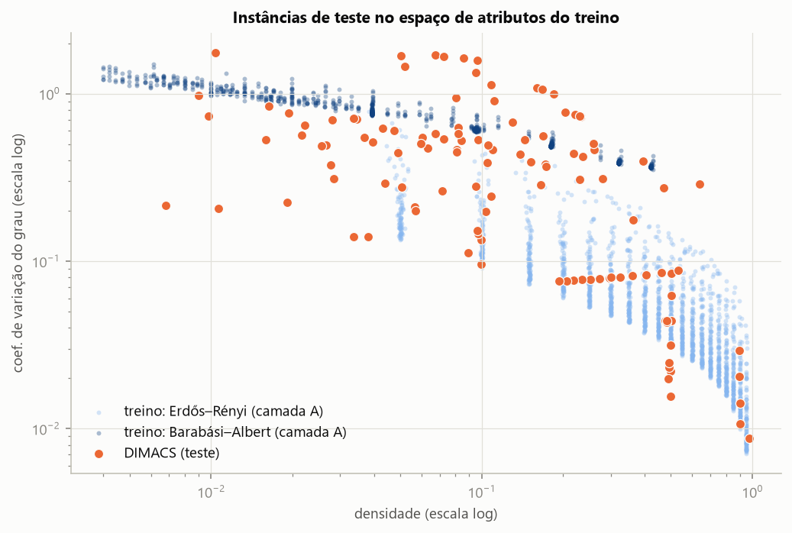
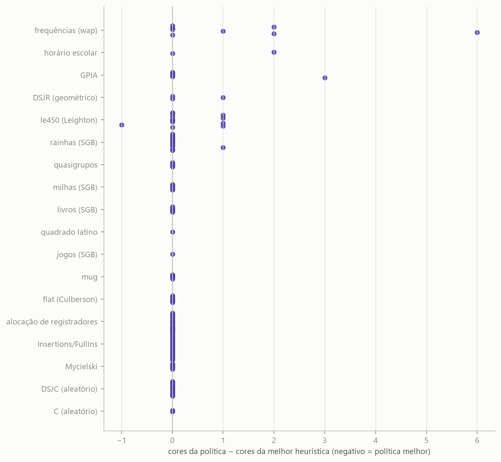

# Teste final no DIMACS

Gerado por `scripts/process_dimacs.py`. A política aprendida da prova de conceito (`results/poc_modelo/modelo.joblib`, sha256 `6bf39632ff60…`) foi aplicada **sem nenhum ajuste**, uma única vez por instância (execução em 2026-11-08).

## 1. Conjunto

127 instâncias (69 com número cromático conhecido na fonte), n de 11 a 10.000.

| família | instancias | n_min | n_max | densidade | chi_conhecido |
|---|---|---|---|---|---|
| Insertions/FullIns | 25 | 30 | 4146 | 0,051 | 5 |
| alocação de registradores | 14 | 184 | 864 | 0,164 | 14 |
| rainhas (SGB) | 13 | 25 | 256 | 0,297 | 8 |
| DSJC (aleatório) | 12 | 125 | 1000 | 0,502 | 0 |
| le450 (Leighton) | 12 | 450 | 450 | 0,089 | 12 |
| frequências (wap) | 8 | 905 | 5231 | 0,050 | 0 |
| flat (Culberson) | 6 | 300 | 1000 | 0,487 | 6 |
| milhas (SGB) | 5 | 128 | 128 | 0,260 | 5 |
| GPIA | 5 | 662 | 1916 | 0,019 | 0 |
| Mycielski | 5 | 11 | 191 | 0,218 | 5 |
| livros (SGB) | 5 | 74 | 561 | 0,080 | 5 |
| quasigrupos | 4 | 900 | 10.000 | 0,041 | 4 |
| mug | 4 | 88 | 100 | 0,036 | 4 |
| DSJR (geométrico) | 3 | 500 | 500 | 0,472 | 0 |
| C (aleatório) | 2 | 2000 | 4000 | 0,500 | 0 |
| horário escolar | 2 | 352 | 385 | 0,247 | 0 |
| jogos (SGB) | 1 | 120 | 120 | 0,089 | 1 |
| quadrado latino | 1 | 900 | 900 | 0,760 | 0 |

## 2. Heurísticas

| heurística | melhor c/ empate | melhor sozinha | % acima da melhor (média) |
|---|---|---|---|
| Aleatória | 24% | 0% | 23,2% |
| Welsh-Powell | 46% | 0% | 16,2% |
| DSATUR | 61% | 5% | 5,7% |
| RLF | 95% | 38% | 0,6% |

Categoria vencedora por família (nº de instâncias):

| família | DSATUR | RLF | empate DSATUR = RLF |
|---|---|---|---|
| C (aleatório) | 0 | 2 | 0 |
| DSJC (aleatório) | 0 | 10 | 2 |
| DSJR (geométrico) | 1 | 1 | 1 |
| GPIA | 1 | 3 | 1 |
| Insertions/FullIns | 0 | 0 | 25 |
| Mycielski | 0 | 0 | 5 |
| alocação de registradores | 0 | 0 | 14 |
| flat (Culberson) | 0 | 6 | 0 |
| frequências (wap) | 2 | 3 | 3 |
| horário escolar | 1 | 1 | 0 |
| jogos (SGB) | 0 | 0 | 1 |
| le450 (Leighton) | 1 | 7 | 4 |
| livros (SGB) | 0 | 0 | 5 |
| milhas (SGB) | 0 | 0 | 5 |
| mug | 0 | 0 | 4 |
| quadrado latino | 0 | 1 | 0 |
| quasigrupos | 0 | 4 | 0 |
| rainhas (SGB) | 0 | 11 | 2 |

## 3. Política aprendida × heurísticas

Comparação com a melhor das 4 heurísticas em cada instância (Δ = cores da política − cores da melhor heurística; negativo = política melhor). "Segue" = fração dos passos em que a política escolheu a sugestão da heurística.

| família | instâncias | < melhor | = melhor | > melhor | Δ médio | segue RLF | segue DSATUR |
|---|---|---|---|---|---|---|---|
| C (aleatório) | 2 | 0 | 2 | 0 | +0,00 | 100% | 9% |
| DSJC (aleatório) | 12 | 0 | 12 | 0 | +0,00 | 92% | 25% |
| DSJR (geométrico) | 3 | 0 | 2 | 1 | +0,33 | 67% | 41% |
| GPIA | 5 | 0 | 4 | 1 | +0,60 | 100% | 4% |
| Insertions/FullIns | 25 | 0 | 25 | 0 | +0,00 | 33% | 79% |
| Mycielski | 5 | 0 | 5 | 0 | +0,00 | 25% | 90% |
| alocação de registradores | 14 | 0 | 14 | 0 | +0,00 | 29% | 79% |
| flat (Culberson) | 6 | 0 | 6 | 0 | +0,00 | 100% | 12% |
| frequências (wap) | 8 | 0 | 4 | 4 | +1,38 | 1% | 100% |
| horário escolar | 2 | 0 | 1 | 1 | +1,00 | 4% | 99% |
| jogos (SGB) | 1 | 0 | 1 | 0 | +0,00 | 100% | 8% |
| le450 (Leighton) | 12 | 1 | 7 | 4 | +0,25 | 59% | 47% |
| livros (SGB) | 5 | 0 | 5 | 0 | +0,00 | 49% | 60% |
| milhas (SGB) | 5 | 0 | 5 | 0 | +0,00 | 4% | 99% |
| mug | 4 | 0 | 4 | 0 | +0,00 | 100% | 12% |
| quadrado latino | 1 | 0 | 1 | 0 | +0,00 | 100% | 14% |
| quasigrupos | 4 | 0 | 4 | 0 | +0,00 | 100% | 4% |
| rainhas (SGB) | 13 | 0 | 12 | 1 | +0,08 | 99% | 16% |
| **total** | 127 | 1 | 114 | 12 | +0,17 | 57% | 53% |

| referência | política melhor | empate | política pior | Δ médio (cores) |
|---|---|---|---|---|
| melhor heurística | 1% | 90% | 9% | +0,17 |
| RLF | 2% | 91% | 7% | +0,06 |
| DSATUR | 33% | 63% | 4% | -1,43 |

## 4. Distância ao número cromático conhecido (69 instâncias)

| método | atinge χ | excesso médio (%) |
|---|---|---|
| Aleatória | 38% | 34,7% |
| Welsh-Powell | 51% | 28,3% |
| DSATUR | 57% | 19,6% |
| RLF | 64% | 12,6% |
| política aprendida | 64% | 12,7% |

## 5. Oráculo por rollout (n ≤ 500, 89 instâncias)

O oráculo usa menos cores que a melhor heurística em 24% dessas instâncias (ganho médio 0,54 cores, máximo 10); a política aprendida fica, em média, 0,62 cores acima do oráculo. Nunca pior que min(DSATUR, RLF): sim.

## 6. Tempo (mediana por faixa de n)

| n | instancias | DSATUR (s) | RLF (s) | política (s) |
|---|---|---|---|---|
| ≤ 200 | 49 | 0,005 | 0,006 | 1,127 |
| 201–500 | 40 | 0,028 | 0,029 | 4,469 |
| 501–1.000 | 20 | 0,069 | 0,100 | 11,048 |
| 1.001–2.500 | 12 | 0,185 | 0,244 | 27,215 |
| > 2.500 | 6 | 0,896 | 2,511 | 198,594 |

## 7. Figuras

*Figura 1 — Densidade e heterogeneidade dos graus: grafos de treino (ER e BA) e instâncias DIMACS.*

*Figura 2 — Diferença de cores entre a política aprendida e a melhor heurística, por instância e família.*
