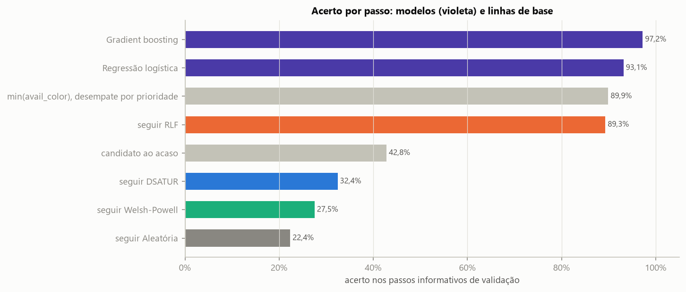
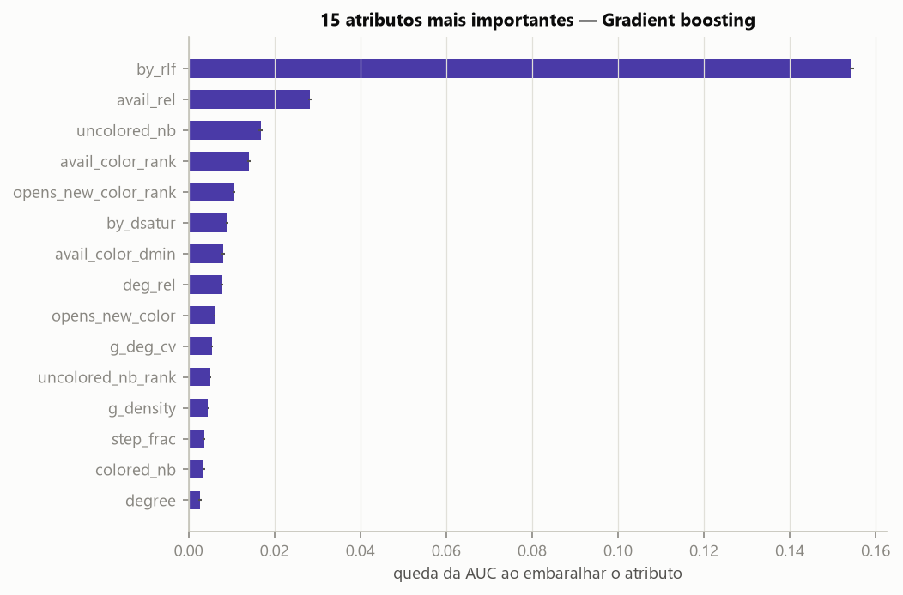
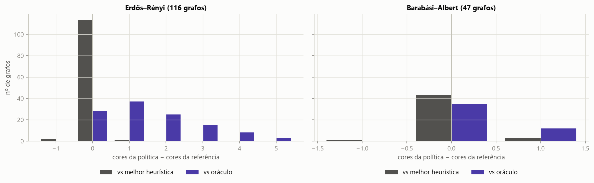
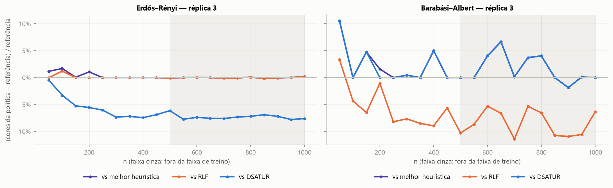

# Prova de conceito do modelo

Gerado automaticamente por `scripts/train_poc.py`. Formulação sugerida na seção 7 da análise exploratória (`results/eda/RELATORIO_EDA.md`). O DIMACS não é usado.

## 1. Formulação e dados

A cada passo da construção gulosa, as 4 heurísticas sugerem candidatos (até 4 vértices distintos). Um classificador binário estima a probabilidade de cada candidato ser ótimo (rótulo 3b da camada B) e a **política aprendida** colore o candidato de maior probabilidade (desempate DSATUR > RLF > WP > aleatória). O treino usa apenas os **passos informativos**.

Divisão **por grafo** (80%/20%), estratificada por modelo gerador e n (semente 2026):

| conjunto | grafos | ER | BA | passos informativos | candidatos (linhas) | rótulo 1 |
|---|---|---|---|---|---|---|
| treino | 650 | 454 | 196 | 105.277 | 407.430 | 42,6% |
| validação | 163 | 116 | 47 | 27.898 | 108.313 | 42,7% |

Atributos (33): do candidato (`degree`, `saturation`, `uncolored_nb`, `colored_nb`, `avail_color`, `opens_new_color`); do passo (`n_colors_before`, `step_frac`, `n_candidates`); relativos (`avail_rel` = avail_color / cores já usadas, `sat_rel`, `unc_frac` = uncolored_nb / grau, `deg_rel` = grau / n); posição do candidato entre os do passo (`*_rank`, posto percentual, e `*_dmin`, diferença para o mínimo do passo); quais heurísticas o sugeriram (`by_*`); e um atributo global por bloco redundante da EDA (`g_n`, `g_density`, `g_deg_cv`, `g_clust_ratio`).

## 2. Desempenho por passo (validação)

Fração dos passos informativos de validação em que o candidato escolhido é ótimo. As linhas de base são as da seção 6 da EDA, recalculadas nos mesmos passos.

| método | acerto geral | acerto ER | acerto BA | acerto no treino | AUC (candidatos) | tempo de treino (s) |
|---|---|---|---|---|---|---|
| Gradient boosting | 97,2% | 97,2% | 98,1% | 98,3% | 0,877 | 13,6 |
| Regressão logística | 93,1% | 93,7% | 76,2% | 93,0% | 0,842 | 4,2 |
| min(avail_color), desempate por prioridade | 89,9% | 90,8% | 62,5% | — | — | — |
| seguir RLF | 89,3% | 90,3% | 58,8% | — | — | — |
| candidato ao acaso | 42,8% | 42,0% | 68,3% | — | — | — |
| seguir DSATUR | 32,4% | 30,3% | 98,8% | — | — | — |
| seguir Welsh-Powell | 27,5% | 26,4% | 64,7% | — | — | — |
| seguir Aleatória | 22,4% | 21,3% | 56,7% | — | — | — |

*Figura 1 — Acerto por passo na validação.*

## 3. Importância dos atributos

Importância por permutação (Gradient boosting, 60.000 candidatos de validação, 3 repetições): quanto a AUC cai quando o atributo é embaralhado. Atributos correlacionados dividem a importância entre si.

| atributo | queda de AUC | desvio |
|---|---|---|
| by_rlf | 0,1544 | 0,0004 |
| avail_rel | 0,0282 | 0,0003 |
| uncolored_nb | 0,0168 | 0,0006 |
| avail_color_rank | 0,0140 | 0,0004 |
| opens_new_color_rank | 0,0107 | 0,0002 |
| by_dsatur | 0,0090 | 0,0002 |
| avail_color_dmin | 0,0081 | 0,0005 |
| deg_rel | 0,0079 | 0,0002 |
| opens_new_color | 0,0060 | 0,0001 |
| g_deg_cv | 0,0054 | 0,0002 |
| uncolored_nb_rank | 0,0051 | 0,0000 |
| g_density | 0,0046 | 0,0002 |
| step_frac | 0,0036 | 0,0002 |
| colored_nb | 0,0036 | 0,0003 |
| degree | 0,0027 | 0,0003 |

*Figura 2 — Importância por permutação.*

## 4. Política aprendida nos grafos de validação da camada B

Cada modelo é usado como regra de escolha para colorir, do início ao fim, os grafos de validação. Toda coloração é validada. Diferenças em nº de cores: negativo = a política usou **menos** cores.

| método | grafos | n | < melhor heurística | = melhor | > melhor | Δ médio vs melhor | Δ médio vs RLF | Δ médio vs DSATUR | Δ médio vs oráculo |
|---|---|---|---|---|---|---|---|---|---|
| Regressão logística | geral | 163 | 0% | 83% | 17% | +0,19 | +0,00 | -2,17 | +1,36 |
| Regressão logística | ER | 116 | 0% | 99% | 1% | +0,01 | +0,00 | -3,31 | +1,56 |
| Regressão logística | BA | 47 | 0% | 45% | 55% | +0,64 | +0,00 | +0,64 | +0,85 |
| Gradient boosting | geral | 163 | 2% | 96% | 2% | +0,01 | -0,18 | -2,36 | +1,17 |
| Gradient boosting | ER | 116 | 2% | 97% | 1% | -0,01 | -0,02 | -3,33 | +1,54 |
| Gradient boosting | BA | 47 | 2% | 91% | 6% | +0,04 | -0,60 | +0,04 | +0,26 |

*Figura 3 — Política aprendida (Gradient boosting) nos grafos de validação da camada B: diferença de cores para a melhor das 4 heurísticas e para o oráculo.*

Com que frequência a política (Gradient boosting) seguiu a sugestão de cada heurística (sugestões coincidentes contam para todas):

| modelo | Aleatória | Welsh-Powell | DSATUR | RLF |
|---|---|---|---|---|
| Barabási–Albert | 3% | 14% | 93% | 13% |
| Erdős–Rényi | 3% | 6% | 20% | 98% |

## 5. Generalização: grafos da camada A com réplica 3

Estes 551 grafos **não estão na camada B** (réplicas 0–2) e nunca foram vistos no treino; os com n > 500 estão fora da faixa de tamanhos do treino. Política: Gradient boosting.

| modelo | faixa | grafos | < melhor heurística | = melhor | > melhor | Δ médio vs melhor | Δ% médio vs melhor | Δ médio vs RLF | Δ médio vs DSATUR | tempo médio política (s) | tempo médio RLF (s) |
|---|---|---|---|---|---|---|---|---|---|---|---|
| Barabási–Albert | n > 500 (fora da faixa) | 90 | 1% | 88% | 11% | +0,11 | +1,7% | -1,21 | +0,11 | 9,14 | 0,040 |
| Barabási–Albert | n ≤ 500 (faixa do treino) | 81 | 0% | 90% | 10% | +0,12 | +1,9% | -0,77 | +0,11 | 3,14 | 0,008 |
| Erdős–Rényi | n > 500 (fora da faixa) | 190 | 5% | 89% | 6% | +0,01 | 0,0% | +0,01 | -8,28 | 8,84 | 0,086 |
| Erdős–Rényi | n ≤ 500 (faixa do treino) | 190 | 1% | 95% | 4% | +0,04 | +0,4% | +0,01 | -3,08 | 3,00 | 0,011 |

*Figura 4 — Diferença relativa de cores da política aprendida por n, nos grafos nunca vistos (negativo = melhor que a referência).*

## 6. Conclusões da prova de conceito

1. **Por passo.** O Gradient boosting acerta 97,2% dos passos informativos de validação, contra 89,9% da melhor linha de base (`min(avail_color), desempate por prioridade`), 89,3% do candidato do RLF e 42,8% ao acaso (treino: 98,3%). Os atributos mais importantes são `by_rlf`, `avail_rel`, `uncolored_nb`.
2. **De ponta a ponta (validação B).** A política usa menos cores que a melhor das 4 heurísticas em 2% dos grafos, o mesmo número em 96% e mais em 2% (ER: 2% / 97% / 1%; BA: 2% / 91% / 6%). Em média fica +1,17 cores acima do oráculo.
3. **Leitura: o modelo aprendeu a escolher a heurística certa para a família, não ainda a superá-la.** Ao colorir, ele seguiu o candidato do RLF em 98% dos passos no ER e o do DSATUR em 93% no BA — exatamente as vencedoras de cada família na EDA. O alto acerto por passo não se converte em menos cores porque os erros se acumulam: os grafos de validação têm em média 195 passos informativos, e 2,8% de erro significa ~5,4 escolhas não ótimas por grafo — cada uma pode custar uma cor, e o ganho do oráculo sobre a melhor heurística nesses grafos é, em média, de 1,17 cores. Superar as heurísticas exige acerto por passo muito mais próximo de 100% nos passos que decidem o resultado, ou uma métrica de treino ligada ao nº final de cores.
4. **Generalização.** Nos 551 grafos nunca vistos, a política supera a melhor heurística em 2% e perde em 7%; com n > 500 (fora da faixa do treino), supera em 4% e perde em 8%.
5. **Custo.** A política é mais lenta que as heurísticas: a cada passo calcula as 4 sugestões e chama o modelo (ver tabela da seção 5). Para a prova de conceito isso é aceitável; no POC II, vale calcular os candidatos de forma incremental.
6. **Limitações e próximos passos (POC II).** (i) O treino usa estados da trajetória do oráculo; ao seguir a própria política, o modelo visita outros estados (mudança de distribuição) — uma extensão natural é rotular também os estados visitados pela política (DAgger). (ii) Todos os erros pesam igual no treino, mas só alguns mudam o nº final de cores; ponderar os exemplos pela diferença de valor entre candidatos (coluna `rollout_colors`) ou aprender a ordenar candidatos pode focar o modelo nos passos decisivos. (iii) Os candidatos se limitam às sugestões das 4 heurísticas: o modelo não pode escolher um vértice que nenhuma delas sugere. (iv) Só grafos ER e BA no treino; o DIMACS dirá se a política generaliza para outras estruturas.
